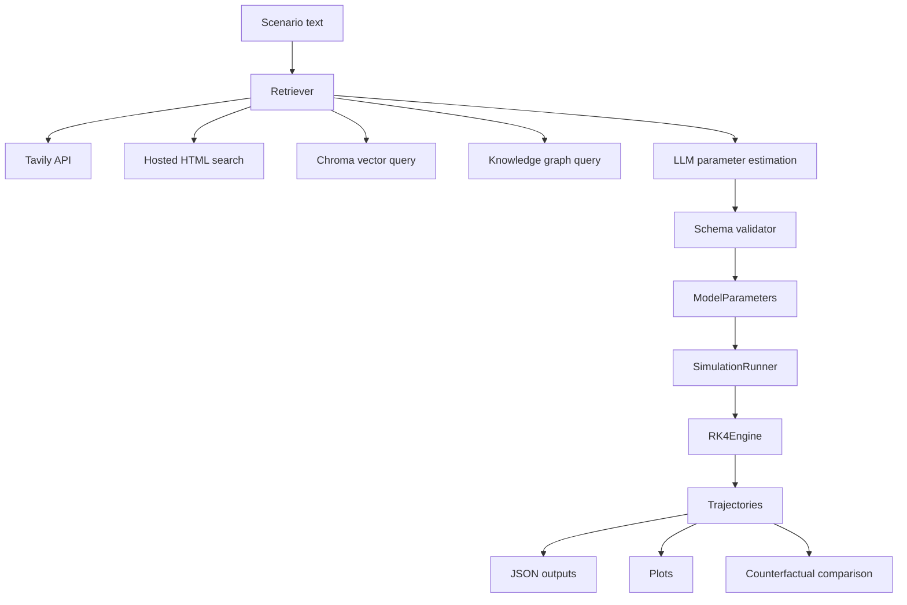
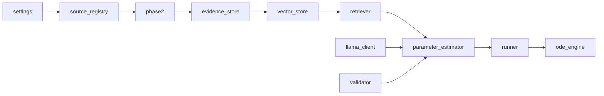

# COMPLETE_PROJECT_DOCUMENTATION

## Table of Contents
1. [Executive Overview](#chapter-1-executive-overview)
2. [Project Context and Functional Scope](#chapter-2-project-context-and-functional-scope)
3. [Technology Stack and Dependencies](#chapter-3-technology-stack-and-dependencies)
4. [Complete Architecture and System Design](#chapter-4-complete-architecture-and-system-design)
5. [Repository and Directory Structure](#chapter-5-repository-and-directory-structure)
6. [Execution Lifecycle and End-to-End Workflows](#chapter-6-execution-lifecycle-and-end-to-end-workflows)
7. [Detailed Module, File, Class, and Function Reference](#chapter-7-detailed-module-file-class-and-function-reference)
8. [Business Logic, Rules, and Decision-Making](#chapter-8-business-logic-rules-and-decision-making)
9. [Data Model and Database Documentation](#chapter-9-data-model-and-database-documentation)
10. [Configuration, Environment, and Secrets](#chapter-10-configuration-environment-and-secrets)
11. [External Integrations and Dependencies](#chapter-11-external-integrations-and-dependencies)
12. [Algorithms, Processing, and Data Transformations](#chapter-12-algorithms-processing-and-data-transformations)
13. [Security, Privacy, and Access Control](#chapter-13-security-privacy-and-access-control)
14. [Error Handling, Reliability, and Observability](#chapter-14-error-handling-reliability-and-observability)
15. [Testing and Quality Assurance](#chapter-15-testing-and-quality-assurance)
16. [Installation, Setup, Execution, and Deployment](#chapter-16-installation-setup-execution-and-deployment)
17. [Performance, Scalability, and Resource Usage](#chapter-17-performance-scalability-and-resource-usage)
18. [Design Decisions and Reasoning Register](#chapter-18-design-decisions-and-reasoning-register)
19. [Known Limitations, Technical Debt, and Improvements](#chapter-19-known-limitations-technical-debt-and-improvements)
20. [Glossary and Domain Concepts](#chapter-20-glossary-and-domain-concepts)
21. [Practical Examples and Troubleshooting](#chapter-21-practical-examples-and-troubleshooting)
22. [Quick Reference and Developer Onboarding](#chapter-22-quick-reference-and-developer-onboarding)
23. [Coverage and Verification Report](#coverage-and-verification-report)

---

## Chapter 1: Executive Overview

**Project:** `energy-seihr`  
**Core purpose:** simulate coupled dynamics between energy/fossil dependency and public-health burden using a multi-region SEIHR-X ODE model.

### What problem it addresses
The repository models a closed feedback loop: fossil-intensive energy raises exposure/health burden, and health burden feeds back into policy pressure that can lower fossil dependency (`core/runner.py:140-210`, `description.txt:5-15`).

### Main capabilities implemented
- Data ingestion/normalization from source registry + adapters (`ingestion/phase2.py`)
- Evidence chunk creation (`rag/evidence_store.py`)
- Chroma vector indexing/query with deterministic hashing embeddings (`rag/vector_store.py`)
- Retrieval context assembly from Tavily + local hosted docs + vector store + optional graph (`rag/retriever.py`)
- LLM/fallback parameter estimation and schema-bound validation (`core/parameter_estimator.py`, `llm/llama_client.py`, `llm/validator.py`)
- Coupled RK4 simulation with region-to-region transport (`core/ode_engine.py`, `core/runner.py`)
- Scenario script producing JSON/PNG artifacts and counterfactual comparison (`scripts/run_scenario.py`)
- Backtesting scaffold with synthetic fallback (`validation/backtester.py`)

### Scope boundaries (as implemented)
- Focused terminal workflow, not web app/service.
- No persistent relational DB; storage is files (JSONL/JSON/GEXF/PNG/SQLite from Chroma).
- Several planned components are placeholders (`scripts/build_hosted_pages.py`, `scripts/prepare_ground_truth.py`, `validation/weight_adjuster.py`, `validation/backtest.py`).

### Key limitations
- Delay parameters exist but are not actively applied in derivative equations (`transboundary_lag_days`, `pollution_lag_days`, `policy_response_days` are carried but unused in calculus path).
- Backtesting can run on synthetic “ground truth” when local NHS file is missing (`validation/backtester.py:113-168`).
- Some docs in repo describe aspirational architecture that exceeds current implementation.

---

## Chapter 2: Project Context and Functional Scope

### Covered domains and workflows
1. **Energy-health simulation workflow**: scenario text -> retrieval -> parameter estimation -> simulation -> artifacts (`scripts/run_scenario.py`).
2. **Data ingestion workflow**: registry-defined sources -> normalized records JSONL (`scripts/ingest_sources.py`, `ingestion/phase2.py`).
3. **Evidence indexing workflow**: normalized records -> evidence chunks -> Chroma index (`scripts/build_evidence_store.py`, `scripts/index_chroma.py`).
4. **Validation workflow**: simulation output vs ground-truth/synthetic series (`validation/backtester.py`).

### Functional requirements evidenced by code
- Must support region-wise parameter bundles (`core/parameters.py`)
- Must support multi-region coupled ODEs (`core/runner.py:113-139`)
- Must generate counterfactual comparison (`scripts/run_scenario.py:68-90`)
- Must constrain parameter values within schema bounds (`llm/validator.py`)
- Must persist outputs for reproducibility (`scripts/run_scenario.py:191-239`)

### Out-of-scope / not implemented
- No authentication/authorization system.
- No web UI/dashboard in code.
- No direct production deployment manifests (Docker/K8s/Terraform absent).
- No robust calibration optimization loop (weight adjuster/backtest stubs).

---

## Chapter 3: Technology Stack and Dependencies

### Runtime + libraries
From `requirements.txt` + imports:
- **Python 3.11+** (inferred from syntax and project docs)
- **NumPy**: ODE state vectors, RK4 arrays, metrics calculations (`core/*`, `validation/*`)
- **Pandas**: CSV/XLSX ingestion normalization (`ingestion/defra.py`, `ingestion/phase2.py`)
- **NetworkX**: knowledge graph build/load/query (`knowledge_graph/*`, `scripts/run_scenario.py`)
- **Matplotlib**: artifact plotting (`scripts/run_scenario.py`)
- **python-dotenv**: `.env` loading (`config/settings.py`)
- **tavily-python**: web retrieval (`rag/retriever.py`)
- **openai**: OpenRouter-compatible chat API client (`llm/llama_client.py`)
- **requests**: external API/HTTP file fetch (`ingestion/*`, `ingestion/phase2.py`)
- **openpyxl**: pandas xlsx backend support
- **pdfplumber** (+ fallback to `PyPDF2`): PDF extraction (`ingestion/phase2.py`)
- **chromadb**: vector storage/query (`rag/vector_store.py`)
- **pytest**: automated tests (`tests/`)

### Notable interactions
- Retrieval layer composes Tavily + local docs + Chroma + optional graph.
- LLM layer depends on retrieval output shape; validator clamps outputs to schema.
- Simulation layer consumes validated parameters and is decoupled from retrieval internals.

### Version/compatibility notes
- Exact pinned versions not specified in `requirements.txt`.
- OpenRouter endpoint/model defaults are env-configurable (`config/settings.py:37-40`).

---

## Chapter 4: Complete Architecture and System Design

### Architectural style
- File-centric modular Python architecture.
- Orchestrator scripts invoke reusable package modules.
- Hybrid deterministic + optional external-LLM processing.

### High-level component diagram


### Component dependency map


### Data-flow highlights
- Source definitions in `config/source_registry.json` drive ingestion adapter dispatch (`ingestion/phase2.py:282-293`).
- `NormalizedRecord` is canonical ingestion output (`ingestion/base.py:18-33`).
- `EvidenceChunk` is canonical retrieval corpus unit (`rag/evidence_store.py:10-25`).

### Error and fallback model
- Missing API keys disable Tavily or OpenRouter and trigger local/fallback logic (`rag/retriever.py:37-47`, `llm/llama_client.py:33-36`).
- Missing ground-truth file triggers synthetic generation (`validation/backtester.py:122-135`).

---

## Chapter 5: Repository and Directory Structure

```text
energy-seihr/
  config/                settings + source registry loader/json
  contracts/             parameter schema contracts
  core/                  ODE model core, parameter estimator orchestration
  ingestion/             source clients + registry-driven ingestion
  knowledge_graph/       graph builders and query helpers
  llm/                   OpenRouter client + parameter validator
  rag/                   evidence chunking, vector store, retriever
  validation/            backtesting and metrics
  scripts/               executable orchestration scripts
  tests/                 pytest suite
  math/                  equations, defaults, parameter notes
  data/                  raw/processed/cache/chroma artifacts
  outputs/               generated trajectories/plots/results
  hosted-data/           local static evidence html pages
```

### Key entry points
- Scenario execution: `scripts/run_scenario.py`
- Registry ingestion: `scripts/ingest_sources.py`
- Chunk build: `scripts/build_evidence_store.py`
- Chroma indexing/query: `scripts/index_chroma.py`, `scripts/query_chroma.py`
- Validation: `scripts/phase4_parameter_estimation.py`, `validation/backtester.py`

---

## Chapter 6: Execution Lifecycle and End-to-End Workflows

### Workflow A: Scenario simulation (primary)
1. **Purpose:** run policy/scenario simulation and counterfactual.
2. **Trigger:** `python scripts/run_scenario.py "<scenario>"`
3. **Inputs:** scenario text, optional dates, env/API keys, initial values.
4. **Preconditions:** dependencies installed; repository data paths available.
5. **Execution steps:**
   - Parse args (`run_scenario.py:93-100`)
   - Resolve target/companion region (`llm/llama_client.py:162-245`)
   - Ensure default graph exists (`run_scenario.py:151-189`)
   - Estimate parameters per region (`core/parameter_estimator.py:26-155`)
   - Build scenario + run coupled RK4 (`core/runner.py:53-100`)
   - Build counterfactual + run again (`run_scenario.py:68-77`)
   - Persist JSON + plots (`run_scenario.py:191-319`)
6. **Decision points:** API availability, cache usage, target vs non-target parameter modifications.
7. **Core logic:** SEIHR-X derivatives with transboundary terms (`core/runner.py:140-210`).
8. **Data changes:** files written to `outputs/trajectories`, `outputs/results`, `outputs/plots`.
9. **Outputs:** trajectories, parameter estimates, retrieval trace, three plots, terminal summary.
10. **Failure handling:** many sections catch exceptions and fallback; hard failures propagate in script.
11. **Design rationale:** provides complete end-to-end deterministic path even offline.
12. **Limitations:** inferred region mapping is keyword-based fallback; no temporal lag enforcement.

### Workflow B: Registry ingestion
- **Trigger:** `python scripts/ingest_sources.py --country IND`
- **Core:** source registry -> adapter factory -> fetch -> normalize -> write JSONL.
- **Failure modes:** missing local files, missing API keys/endpoints.

### Workflow C: Evidence indexing
- **Trigger:** `build_evidence_store.py` then `index_chroma.py`
- **Core:** convert normalized records to structured/document chunks then vectorize/index.

### Workflow D: Backtesting
- **Trigger:** `scripts/phase4_parameter_estimation.py` (or direct `Backtester` calls)
- **Core:** predicted H-series vs loaded/synthetic actual H-series -> RMSE/MAE/R².

---

## Chapter 7: Detailed Module, File, Class, and Function Reference

### `core/parameters.py`
- `ModelParameters` dataclass (immutable): full region parameter contract.
- `to_dict()`: serialization for persistence and traces.

### `core/ode_engine.py`
- `SimulationResult`: wraps `time` and `trajectory` arrays.
- `RK4Engine.integrate(...)`: generic RK4 integrator used by simulation runner.

### `core/runner.py`
- `Scenario`: high-level simulation input object.
- `RunOutput`: maps region -> `SimulationResult`.
- `SimulationRunner.run(...)`: orchestrates date-grid build, state concatenation, coupled integration, region slicing.
- `_seihr_derivatives(...)`: core model equations; includes:
  - dynamic `beta = beta_base * (1 + beta_sensitivity*(X-0.5))`
  - transboundary exposure/pollution terms from coupling matrix
  - policy-pressure influence on `X`
  - derivative clipping for `dX/dt`
- `_bound_joint_trajectory(...)`: post-integration clipping to keep populations non-negative and X in [0,1].

### `core/parameter_estimator.py`
- Orchestrates retrieval + LLM + validator + defaults to produce `ModelParameters`.
- Stores detailed per-region trace in `last_trace` used by output artifacts.

### `llm/llama_client.py`
- OpenRouter chat client; optional if key exists.
- `_build_estimation_prompt`: strict JSON request with bounded params.
- `_parse_parameters`: JSON extraction + alias normalization (`lambda` -> `lambda_rate`, etc).
- Deterministic fallback parameter generator keyed by scenario text features.
- `resolve_regions`: LLM-assisted region extraction with fallback keyword mapping.
- `generate_explanation`: optional narrative summary generation.

### `llm/validator.py`
- Loads JSON schema and clamps/coerces parameter dict to expected types/ranges.
- Ensures required fields are filled from defaults when present.

### `ingestion/base.py`
- Canonical types: `SourcePayload`, `NormalizedRecord`, `SourceClient` protocol.

### `ingestion/phase2.py`
- `RegistryIngestionPipeline`: drives registry-based country ingestion.
- Adapter classes:
  - `IndiaEnergyIngestor` (CSV state-year metrics)
  - `GlobalCoalPlantTrackerIngestor` (XLSX unit-level records)
  - `GenericPdfStudyIngestor` (page text extraction)
  - `IndiaAQIIngestor` (API observation normalization)
- `build_ingestor`: adapter registry/factory.

### `ingestion/national_grid.py`, `ingestion/defra.py`, `ingestion/fingertips.py`
- Legacy direct clients used by `ingestion/pipeline.py` and `scripts/prepare_normalized_records.py`.

### `rag/evidence_store.py`
- `EvidenceChunk` model.
- `EvidenceStoreBuilder.build()`: read normalized records -> emit chunk JSONL + manifest.
- Structured fact sentence generation and document-page chunking logic.

### `rag/vector_store.py`
- `HashingEmbeddingModel`: deterministic local embedding without external model dependency.
- `ChromaEvidenceStore`: reset, index, vector query, hybrid rerank query.
- Metadata flattening and lexical-scoring helpers.

### `rag/retriever.py`
- `Retriever.retrieve(...)`: central retrieval orchestration with caching.
- Combines Tavily results, local HTML snippets, vector retrieval, and graph context.
- `format_for_llm(...)`: builds text packet consumed by parameter-estimation prompt.

### `knowledge_graph/builder.py`
- Builds directed graph from normalized records and links records to region nodes.

### `knowledge_graph/querier.py`
- Region-based record retrieval from GEXF graph.

### `validation/backtester.py`
- `ValidationMetrics`, `BacktestResult`, `Backtester`.
- Computes RMSE/MAE/R²/peak error.
- Ground truth loader with synthetic fallback generation.

### `validation/metrics.py`
- `Metrics.mse` + `AdvancedMetrics` helpers for burden error, prior violations, and heuristic faithfulness.

### Stub/placeholder modules
- `validation/backtest.py`, `validation/weight_adjuster.py`, `scripts/build_hosted_pages.py`, `scripts/prepare_ground_truth.py`.

---

## Chapter 8: Business Logic, Rules, and Decision-Making

### Rule groups
1. **Parameter safety bounds**
   - Implemented in schema + validator clamp.
2. **Scenario-vs-counterfactual differentiation**
   - Counterfactual raises pollution pressure / lowers policy response for target region (`run_scenario.py:137-148`).
3. **Downwind policy dampening**
   - Non-target region gets capped `kappa` (`run_scenario.py:133-135`).
4. **Transboundary influence**
   - Coupling matrix directional weights define inter-region transfer.
5. **Fallback determinism**
   - If OpenRouter/Tavily unavailable, still produce a complete run.

### Decision table (selected)

| Condition | Outcome |
|---|---|
| `OPENROUTER_API_KEY` missing | Use deterministic parameter fallback |
| `TAVILY_API_KEY` missing | Tavily results empty; local evidence still used |
| Missing ground-truth json | Synthetic H-series generated |
| `X` leaves [0,1] during integration | Clipped in `_bound_joint_trajectory` |
| `dX/dt` too large | Clipped to [-0.1, 0.1] |

---

## Chapter 9: Data Model and Database Documentation

### Primary data structures

#### `NormalizedRecord` (`ingestion/base.py`)
Fields include source identifiers, semantic record type, period, region, value/unit, metadata/provenance, optional geo/admin metadata.

#### `EvidenceChunk` (`rag/evidence_store.py`)
Chunk-level retrieval unit with IDs, content, type (`structured_fact` / `document_chunk`), metadata, and provenance.

#### `ModelParameters` (`core/parameters.py`)
Region-level simulation parameter object.

### Persistent storage used
- JSON/JSONL under `data/processed`, `outputs/*`
- Knowledge graph GEXF (`outputs/knowledge_graph.gexf`)
- Chroma persisted directory (`data/chroma`) including `chroma.sqlite3` and binary index files

### Database objects
- No project-owned SQL schema/migrations/tables are defined.
- Chroma internals exist as tool-managed persistence, not manually modeled by project code.

---

## Chapter 10: Configuration, Environment, and Secrets

### Configuration sources
- `.env` (runtime)
- defaults in `config/settings.py`
- source registry JSON in `config/source_registry.json`

### Environment variable reference

| Variable | Purpose | Required | Default | Used in | Sensitivity |
|---|---|---|---|---|---|
| `TAVILY_API_KEY` | Tavily retrieval API | Optional (fallback exists) | None | `settings`, `Retriever` | Secret |
| `OPENROUTER_API_KEY` | LLM API auth | Optional (fallback exists) | None | `settings`, `LlamaClient` | Secret |
| `OPENROUTER_BASE_URL` / `BASE_URL` | OpenRouter endpoint | Optional | `https://openrouter.ai/api/v1` | `settings` | Non-secret |
| `OPENROUTER_MODEL` / `MODEL` | Chat model ID | Optional | `openai/gpt-4o-mini` | `settings` | Non-secret |
| `OPENROUTER_SITE_URL` | Referer header | Optional | `http://localhost` | `LlamaClient` | Non-secret |
| `OPENROUTER_APP_NAME` | Title header | Optional | `energy-seihr` | `LlamaClient` | Non-secret |
| `DATA_NATIONAL_GRID` | Source URL | Optional | None | settings, ingestion scripts | Non-secret |
| `DATA_CARBON_INTENSITY_API` | Source URL | Optional | None | legacy normalization script | Non-secret |
| `DATA_DEFRA_PM25` | Source URL | Optional | None | legacy normalization script | Non-secret |
| `DATA_NHS_FINGERTIPS` | Source URL | Optional | None | legacy normalization script | Non-secret |
| `TAVILY_ALLOWED_URLS` | CSV of allowlisted URLs | Optional | derived from DATA_* | retrieval | Non-secret |
| `SOURCE_REGISTRY_PATH` | registry file path | Optional | `config/source_registry.json` | registry loader | Non-secret |
| `VECTOR_DB_PROVIDER` | vector backend label | Optional | `chroma` | settings only | Non-secret |
| `CHROMA_PERSIST_DIR` | Chroma storage dir | Optional | `data/chroma` | vector store | Non-secret |
| `EMBEDDING_PROVIDER` | embedding backend label | Optional | `hashing` | settings only | Non-secret |
| `EMBEDDING_DIMENSION` | embedding vector size | Optional | `384` | vector store | Non-secret |
| `AIR_QUALITY_API_KEY_INDIA` | India AQI API key | Optional unless live API used | None | ingestion phase2 | Secret |
| `BACKTEST_START/SPLIT/END` | backtest period defaults | Optional | preset dates | settings | Non-secret |
| `DEFAULT_REGION` | fallback region | Optional | `UK_Yorkshire` | scenario helpers | Non-secret |
| `DEFAULT_SIMULATION_YEARS` | inferred horizon | Optional | `5` | scenario script | Non-secret |

### Secret handling notes
- Secrets are referenced via env var names only; no hardcoded secrets in reviewed code.

---

## Chapter 11: External Integrations and Dependencies

1. **Tavily API**
   - Used for web search context enrichment.
   - Failure tolerated; workflow continues with local sources.
2. **OpenRouter (via OpenAI SDK)**
   - Used for parameter estimation and explanation generation.
   - Failure tolerated with deterministic fallback parameters.
3. **Data.gov.in AQI endpoint**
   - Accessed in India AQI ingestor when `include_live_apis` is enabled.
4. **Potential remote data URLs for legacy ingestion clients**
   - National Grid, DEFRA, NHS endpoints fetched through `requests`.

No explicit retry/backoff policy is implemented beyond direct try/except fallback behavior.

---

## Chapter 12: Algorithms, Processing, and Data Transformations

### A. RK4 integration
- Time complexity: `O(T * D)` derivative evaluations with RK4 multiplier 4, where `T` = timesteps and `D` = state dimension.
- Used for numerical stability over daily step integration.

### B. Coupled SEIHR-X derivative update
- Per region: computes local exposure + incoming transboundary effects.
- Maintains bounded state via clipping post-integration and for `dX/dt`.

### C. Hashing embedding model
- Token hashing into fixed-dimension signed vector + L2 normalization.
- Deterministic and dependency-light; lower semantic fidelity than transformer embeddings.

### D. Hybrid retrieval scoring
- Combines lexical overlap score with weighted vector score (`rag/vector_store.py:228-249` and `148`).

### E. Evidence chunk transformation
- Structured records -> synthesized fact sentences.
- Document pages -> sliding-word chunks with overlap.

---

## Chapter 13: Security, Privacy, and Access Control

### Verified protections
- API keys sourced from environment (not code literals).
- Bounded parameter validation helps reduce malformed LLM output risk.
- Metadata truncation for Chroma fields reduces excessive payload size (`_put_metadata`).

### Gaps and concerns
- No authN/authZ because no service boundary is implemented.
- External content is ingested with limited sanitization/validation.
- Retrieval text and generated content are printed/written; operational environments should ensure logs/artifacts do not expose sensitive upstream data.
- No explicit dependency vulnerability scanning pipeline in repo.

---

## Chapter 14: Error Handling, Reliability, and Observability

### Error handling patterns
- Broad exception catches with fallback in retriever, LLM client, and ground-truth loading.
- Some scripts are strict (raise `SystemExit`) for missing config.

### Reliability characteristics
- Offline execution remains possible for core scenario flow.
- Determinism exists in fallback logic + simulation for fixed inputs.

### Observability
- Primarily stdout logging.
- Retrieval trace and parameter JSON provide post-run audit artifacts (`outputs/results/*_retrieval_trace.json`, `*_parameter_estimates.json`).

---

## Chapter 15: Testing and Quality Assurance

### Test suite coverage (`tests/`)
- Ingestion normalization and source registry checks
- Evidence chunking and vector retrieval/hybrid reranking
- Retriever formatting/local HTML extraction
- LLM parsing and parameter clamping
- ODE bounds and coupling behavior
- Knowledge graph context integrity
- Evaluation-oriented integration/regression tests

### Test commands discovered
- `python scripts/test_simulation_core.py`
- `pytest` (implied by suite + dependency)

### Execution status for this documentation task
- No tests were executed during this documentation-only update.
- Existing tests are documented from source inspection only.

---

## Chapter 16: Installation, Setup, Execution, and Deployment

### Local setup
1. `python -m venv venv`
2. activate environment
3. `pip install -r requirements.txt`
4. copy `.env.sample` to `.env` and populate optional keys

### Core execution paths
- Run a scenario:
  - `python scripts/run_scenario.py "close all gas plants in Yorkshire by 2027"`
- Ingest registry sources:
  - `python scripts/ingest_sources.py --country IND`
- Build evidence + index:
  - `python scripts/build_evidence_store.py --country IND`
  - `python scripts/index_chroma.py --country IND --reset`
- Query vector store:
  - `python scripts/query_chroma.py "Delhi PM2.5 coal" --country IND`

### Deployment status
- No production deployment pipeline (containers/IaC/CD) is implemented in inspected files.

---

## Chapter 17: Performance, Scalability, and Resource Usage

### Existing performance traits
- RK4 simulation is vectorized at region-state level and suitable for modest region counts.
- Chroma indexing supports batching (`batch_size` parameter).
- Hybrid query currently performs full collection `get()` for lexical rerank, which can become expensive at large corpus sizes (`rag/vector_store.py:137-154`).

### Scalability constraints
- Monolithic in-process orchestration (single Python process).
- No queue, worker pool, or asynchronous pipeline.
- Retrieval and simulation are tightly script-coupled, not service-oriented.

---

## Chapter 18: Design Decisions and Reasoning Register

| Decision | Evidence | Explicit rationale? | Engineering assessment |
|---|---|---|---|
| Use RK4 for integration | `core/ode_engine.py` | Partially (docs + implementation) | Good accuracy/stability tradeoff for compartment ODEs |
| Keep `ModelParameters` immutable | `core/parameters.py` | Not explicit | Reduces accidental mutation across pipeline steps |
| Offline fallback for LLM/retrieval | `llm/llama_client.py`, `rag/retriever.py` | Yes (printed messages and code paths) | Improves reliability and demo continuity |
| Use Chroma + hashing embeddings | `rag/vector_store.py` | Partially | Fast local bootstrap; may reduce semantic quality |
| Clamp parameter and trajectory values | `llm/validator.py`, `core/runner.py` | Yes in comments/code | Prevents unstable/unphysical outputs; may hide model misspecification |
| Counterfactual via parameter perturbation | `scripts/run_scenario.py:137-148` | Not deeply documented | Practical what-if mechanism; assumptions should be calibrated |

Where historical motivation is not stated in code/docs, this report treats rationale as technical interpretation.

---

## Chapter 19: Known Limitations, Technical Debt, and Improvements

1. **Declared lag parameters not applied in ODE transitions** (high impact on realism).
2. **Backtesting synthetic fallback can mask real model error** if real NHS data absent.
3. **Placeholder modules** indicate incomplete planned functionality.
4. **Inconsistent/aspirational docs** in repo may mislead maintainers vs actual behavior.
5. **No strict retry/backoff/circuit-breaking** for external integrations.
6. **Hybrid lexical rerank scalability issue** due to wide collection scan.
7. **No formal deployment/ops model** for production execution.
8. **No unit-normalization contract beyond ad hoc metadata** for some ingested sources.

---

## Chapter 20: Glossary and Domain Concepts

- **SEIHR**: Susceptible, Exposed, Affected/Infected, Hospitalized, Recovered compartments.
- **X state**: fossil dependency / pollution intensity scalar in `[0,1]`.
- **Coupling matrix**: directional inter-region influence weights.
- **Counterfactual**: modeled no-intervention baseline for comparison.
- **Backtesting**: comparison of model output vs historical/ground-truth data.
- **Evidence chunk**: retrieval unit derived from normalized records.
- **GraphRAG (project context)**: retrieval approach combining graph context and vector/local evidence.

---

## Chapter 21: Practical Examples and Troubleshooting

### Typical successful run (scenario)
- Command: `python scripts/run_scenario.py "close all gas plants in Yorkshire by 2027"`
- Produces:
  - `outputs/trajectories/<slug>.json`
  - `outputs/trajectories/<slug>_counterfactual.json`
  - `outputs/results/<slug>_retrieval_trace.json`
  - `outputs/results/<slug>_parameter_estimates.json`
  - `outputs/plots/<slug>_{trajectory,comparison,transboundary}.png`

### Common failure cases
- Missing OpenRouter key -> deterministic fallback parameters.
- Missing Tavily key -> no remote search, local-only retrieval context.
- Chroma unavailable/import error -> retriever warns and continues without vector search.
- Missing ground truth -> synthetic data used for validation.

### Troubleshooting checklist
1. Verify `.env` variables.
2. Confirm `data/processed/*` exists before indexing/querying.
3. Confirm `data/chroma` writable.
4. Validate source registry with `scripts/validate_source_registry.py`.

---

## Chapter 22: Quick Reference and Developer Onboarding

### One-paragraph purpose
`energy-seihr` is a Python simulation pipeline that transforms policy-style scenario text into parameterized multi-region SEIHR-X ODE simulations, using retrieval + optional LLM estimation, and emits trajectory/comparison artifacts for health-energy what-if analysis.

### Major components
- **Ingestion**: `ingestion/*`, `scripts/ingest_sources.py`
- **Retrieval/RAG**: `rag/*`
- **LLM and validation**: `llm/*`, `core/parameter_estimator.py`
- **Simulation core**: `core/runner.py`, `core/ode_engine.py`
- **Validation**: `validation/backtester.py`

### Critical files
- `scripts/run_scenario.py` (end-to-end runner)
- `core/runner.py` (model equations + orchestration)
- `llm/llama_client.py` (LLM + fallback)
- `rag/retriever.py` (context assembly)
- `config/settings.py` and `.env.sample` (runtime config)

### Suggested reading order
1. `README.md`
2. `scripts/run_scenario.py`
3. `core/runner.py` + `core/parameters.py`
4. `core/parameter_estimator.py` + `llm/*`
5. `rag/*`
6. `ingestion/phase2.py` + `config/source_registry*`
7. `validation/backtester.py`
8. `tests/*`

### High-risk areas
- Parameter realism/calibration.
- Synthetic fallback misuse in validation.
- Data leakage risk from retrieval cache timestamps.
- Large-scale retrieval performance.

### Unresolved questions for maintainers
1. Which workflows are production vs prototype/demo?
2. What exact real-world metric should map to `H`?
3. Should lag parameters be implemented or removed from contract?
4. What is the intended canonical region ontology and mapping rules?
5. Which docs in repo are authoritative when conflicting?

---

## Coverage and Verification Report

### Coverage matrix

| Area | Coverage status | Notes |
|---|---|---|
| `config/` | Complete | settings + registry code and json inspected |
| `core/` | Complete | runner, estimator, ODE, parameters inspected |
| `ingestion/` | Complete | legacy and phase2 pipelines inspected |
| `knowledge_graph/` | Complete | builder + querier + node types inspected |
| `llm/` | Complete | client, validator, estimator stub inspected |
| `rag/` | Complete | evidence store, vector store, retriever inspected |
| `validation/` | Complete | backtester + metrics + stubs inspected |
| `scripts/` | Complete | all script files inspected |
| `tests/` | Complete | all test files inspected |
| `contracts/`, `math/` | Complete | schema, equations, defaults inspected |
| Data/artifact folders | Partial | structure and sample artifacts inspected; not all raw data values exhaustively audited |
| Runtime execution | Partial | code paths traced; tests not executed in this doc task |

### Verification notes
- Source references are based on direct file inspection.
- Assertions about runtime behavior are derived from code paths unless explicitly marked as unexecuted.
- No credentials or secret values are included.

